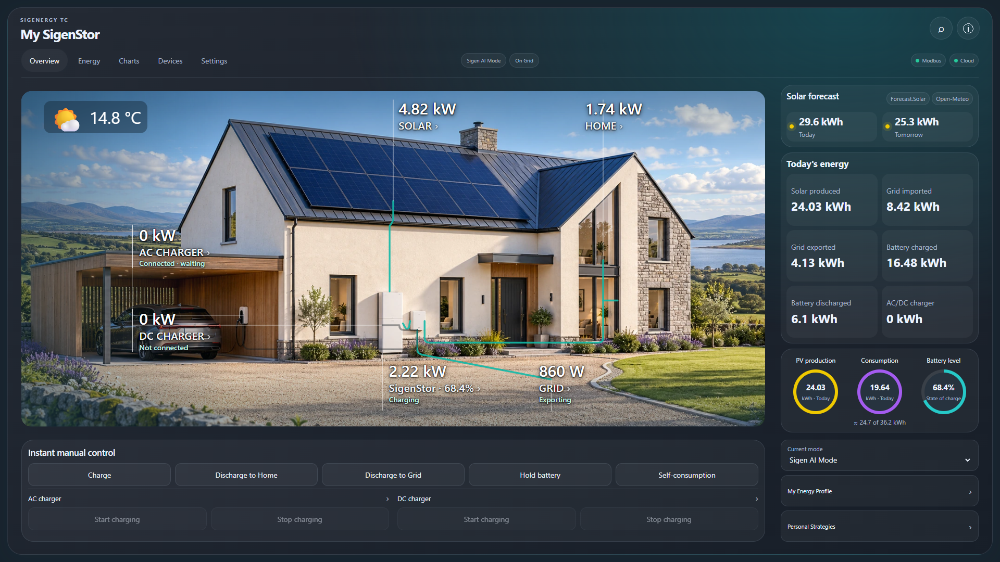
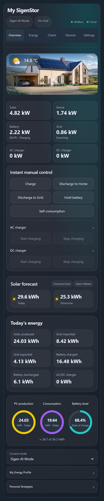
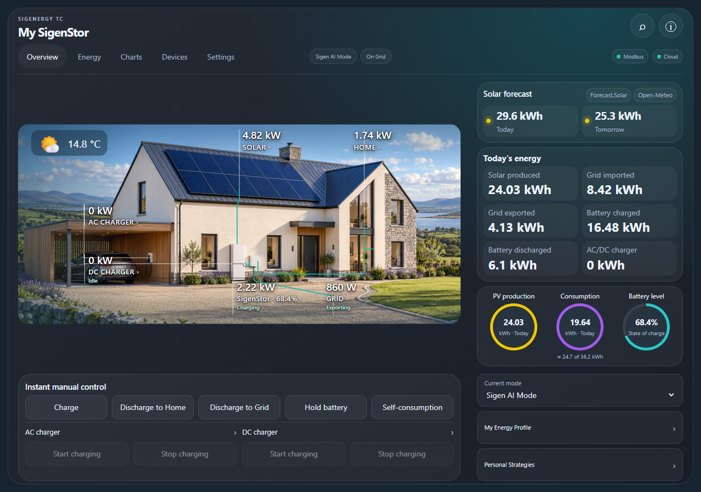

# Sigenergy TC — Total Control for Home Assistant

> **Public Beta · 0.2.9**
>
> Sigenergy TC can change battery operation, EV charging and grid connection. Review the [control and recovery guide](docs/controls-and-recovery.md) before enabling writes.

  
  

A local-first Home Assistant integration and responsive energy dashboard for SigenStor systems. Use **Modbus**, **mySigen Cloud**, or **both**. Each owner supplies their own cloud credentials. No developer application, NBI key, hosted MBS backend or VPP registration is needed.

[0.2.9 Beta release notes](docs/release-0.2.9.md) · [Installation and setup](docs/installation.md) · [Manual ZIP installation](docs/installation.md#manual-installation) · [User guide](docs/user-guide.md) · [Validation and acceptance scope](docs/acceptance.md)

## Features

- Local power, battery SOC, native energy counters and persistent daily baselines, with cached measured Cloud daily buckets covering the first installation day. Independent cloud availability lets Modbus continue during internet failures.
- Optional cached cloud telemetry, history, supported operating modes, discovered battery modules, gateway and charger information. Existing mySigen Personal Strategies, tariffs and device configuration are read through your configured Cloud login; see [native settings and coverage](docs/native-settings.md). Native Personal Strategies also have [New, Change, Rename and Delete controls](docs/native-strategies.md), subject to the documented hardware acceptance scope.
- Real local/cloud battery charge, discharge to home, discharge to grid, hold and self-consumption commands; native cloud mode selection, gateway switching and AC/DC charger start/stop.
- Owner SOC, battery/PV power, backup reserve, grid power/current, energy priorities, peak-shaving and AC/DC charging-mode settings. Popups read actual settings and reject stale edits. [Setting formats and availability](docs/owner-settings.md).
- Durable command journal, fresh identity/permission checks, finite power/SOC bounds and compare-before-restore recovery. Cloud manual commands use native expiry; explicitly enabled local commands use HA-managed timing and native SOC thresholds. Owner changes take priority.
- Personal time/SOC strategies with explicit master enable, overnight and DST handling, priority conflict detection and bounded native leases.
- Local buying/selling tariffs, weekly periods and seasons. A separate forecast-based charging planner produces recommendations; financial optimization is advisory.
- Forecast.Solar, Open-Meteo Solar Forecast, Solcast and Volcast integrations as optional cached sources; average up to two sources covering the same panels.
- Charger connection states read independently of power, and a persistent manual-override countdown with Cancel in the control header.
- Photo House, House and Flow scenes; automatic day/night appearance and weather effects; phone, tablet and desktop layouts; standalone charts, summaries and control cards.
- Existing-dashboard embedding, visual card configuration, light/dark themes, sanitized diagnostics and optional local connection notifications.

**Boundaries:** all implemented writes are available to an owner who enables their control connection; an upgrade never silently enables an existing entry. Local timing requires HA to remain running, and local home-only discharge caps total grid export at zero. Cloud discharge can block battery export while allowing PV export. Installer/protection settings, V2X dispatch, firmware operations, external AI execution, direct Tigo discovery and native charger scheduling are not implemented as working controls. [Full capability matrix](docs/compatibility.md).

Use **Settings → Devices & services → Sigenergy TC → Configure → Add to dashboard** to place the full interface on an existing editable page or supported custom-shell menu. Embedded layouts measure their available space below dashboard headers. See [dashboard placement and sizing](docs/dashboard-embedding.md).

## Install with HACS as a custom repository

1. Back up Home Assistant and record the plant's existing mySigen settings. Keep the existing integration and automations intact until conflicts have been reviewed.
2. In **HACS → menu → Custom repositories**, add `https://github.com/mbsintegrations/HomeAssistant-Sigenergy-TC` with category **Integration**.
3. Download **Sigenergy TC (Total Control)** version **0.2.9**, restart Home Assistant, then use **Settings → Devices & services → Add integration → Sigenergy TC**.
4. Choose Modbus, Cloud, or both. Cloud login discovers the plant; no station ID is entered. Configure safety limits and deliberately choose whether to enable control.
5. Open **Settings → Devices & services → Sigenergy TC → Configure → Add to dashboard**. Choose your existing dashboard and page, or a supported custom-menu destination. For a separate dashboard, new page or individual cards, follow the [illustrated dashboard guide](docs/dashboard-embedding.md#choose-where-to-put-it). No YAML or third-party cards are required for a normal editable HA dashboard.

Requires **Home Assistant 2026.10.1 or later**. Use the custom repository steps while the project is outside the default HACS catalogue. **Open HACS** opens the repository in your Home Assistant instance. **Add Integration** opens the setup wizard after installation and restart.

[Installation and upgrades](docs/installation.md) · [Controls and recovery](docs/controls-and-recovery.md) · [Strategies and tariffs](docs/strategies.md) · [Existing mySigen settings](docs/native-settings.md) · [Cards](docs/cards.md) · [Embedding](docs/dashboard-embedding.md) · [Charts](docs/chart-catalogue.md) · [Troubleshooting](docs/troubleshooting.md) · [Screenshots](docs/screenshots.md) · [Changes](CHANGELOG.md)

## Screenshots

Screenshots use illustrative, non-private example readings. They demonstrate the interface, not physical command acceptance.

 

## Development and support

**Bug reports and feature requests: [GitHub Issues only](https://github.com/mbsintegrations/HomeAssistant-Sigenergy-TC/issues).** Please do not send them by email, Facebook, Messenger or private message. See [what to include](SUPPORT.md).

Run `python -m pytest -q`, `ruff check custom_components tests tools`, and `npm test`. GitHub Actions runs those tests plus official Hassfest and HACS validation, without ignored checks. Software tests use synthetic transports; they do not prove real-world plant behavior. See [contributing](CONTRIBUTING.md), [security](SECURITY.md), and [Beta testing](docs/alpha-testing.md).

Code and original artwork: **GPL-3.0-only**. Third-party adaptations retain their notices in [THIRD_PARTY_NOTICES.md](THIRD_PARTY_NOTICES.md). Sigenergy and other product names remain their owners' trademarks. No affiliation or endorsement is claimed.
