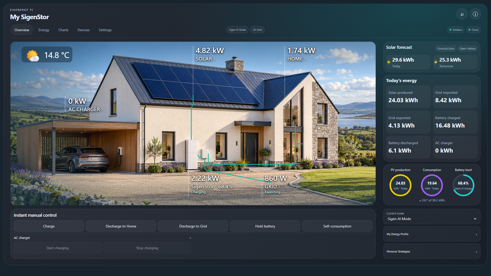
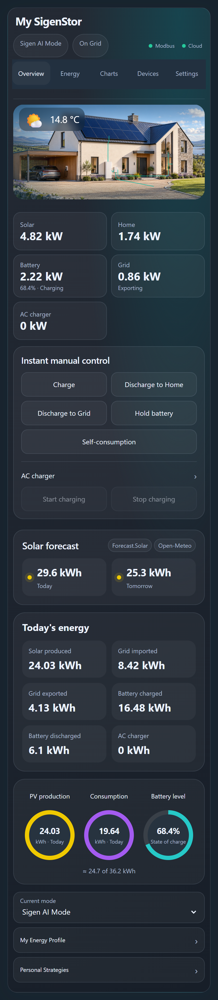
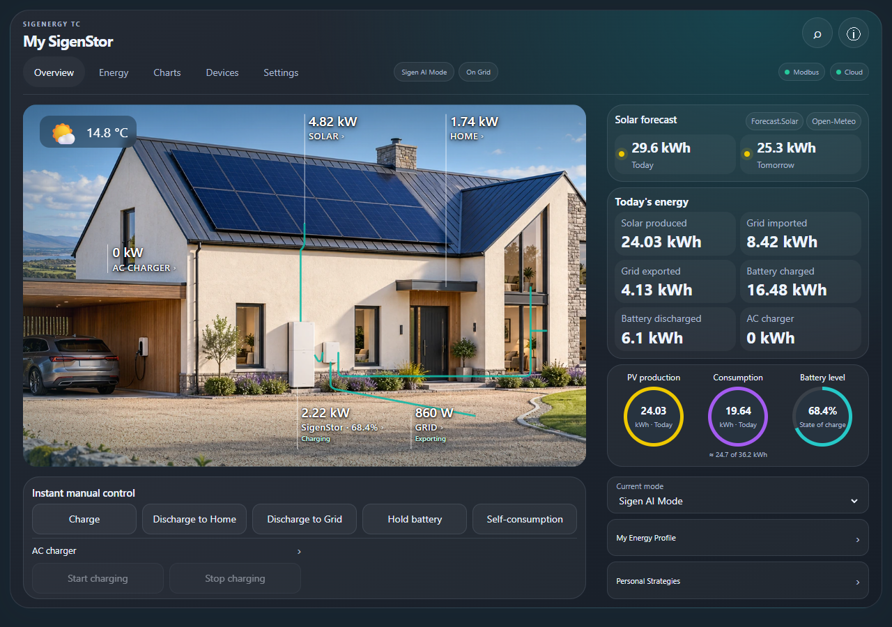

# Sigenergy TC (Total Control)

> **INVITATION-ONLY ALPHA — DO NOT INSTALL unless you have been invited by MBS Integrations.**
>
> Version **0.1.0** is an experimental, owner-supervised control release. It is not a stable release or a Sigenergy product. Real commands can change battery operation, charging and grid connection. Read the [control and recovery guide](docs/controls-and-recovery.md) before enabling control.

A local-first Home Assistant integration and responsive energy dashboard for SigenStor systems. Use **Modbus**, **mySigen Cloud**, or **both**. Each owner supplies their own cloud credentials. No developer application, NBI key, hosted MBS backend or VPP registration is needed.

## Features

- Local power, battery SOC, native energy counters and persistent daily baselines. Independent cloud availability lets Modbus continue during internet failures.
- Optional cached cloud telemetry, history, supported operating modes, discovered battery modules, gateway and charger information.
- Real cloud manual charge, discharge to home, discharge to grid, hold and self-consumption commands; native mode selection, gateway switching, AC/DC charger start/stop and owner SOC limits.
- Durable command journal, fresh identity/permission checks, finite power/SOC bounds, native manual expiry and compare-before-restore recovery. Owner changes take priority.
- Personal time/SOC strategies with explicit master enable, overnight and DST handling, priority conflict detection and bounded native leases.
- Local buying/selling tariffs, weekly periods and seasons. A separate forecast-based charging planner produces recommendations; financial optimization is advisory.
- Forecast.Solar, Open-Meteo Solar Forecast, Solcast and Volcast integrations as optional cached sources; average up to two sources covering the same panels.
- Photo House, House and Flow scenes; automatic day/night appearance and weather effects; phone, tablet and desktop layouts; standalone charts, summaries and control cards.
- Existing-dashboard embedding, visual card configuration, light/dark themes, sanitized diagnostics and optional local connection notifications.

**Boundaries:** timed Modbus EMS writes remain locked because device-side expiry has not been verified. Cloud control requires explicit owner enablement and an available supported app interface. Installer/protection settings, V2X control and firmware operations are not exposed as working controls. AI execution, direct Tigo discovery and native charger scheduling are not implemented. [Full capability matrix](docs/compatibility.md).

## Invited testers: install with HACS

1. Back up Home Assistant and record the plant's existing mySigen settings. Keep the existing integration and automations intact until conflicts have been reviewed.
2. In **HACS → menu → Custom repositories**, add `https://github.com/mbsintegrations/Sigenergy-TC` with category **Integration**.
3. Download **Sigenergy TC**, restart Home Assistant, then use **Settings → Devices & services → Add integration → Sigenergy TC**.
4. Choose Modbus, Cloud, or both. Cloud login discovers the plant; no station ID is entered. Configure safety limits and deliberately choose whether to enable control.
5. Add **Sigenergy TC** in a dashboard's card picker. The bundled module registers automatically in storage-mode dashboards; select the integration entry in the visual editor if more than one is installed.

Requires **Home Assistant 2026.10.1 or later**. This repository is public for HACS testing, but is **not submitted to the HACS default catalogue**. The invitation notice describes supported alpha participation; it does not add license restrictions or technical access control.

[Installation and upgrades](docs/installation.md) · [Controls and recovery](docs/controls-and-recovery.md) · [Strategies and tariffs](docs/strategies.md) · [Cards](docs/cards.md) · [Embedding](docs/dashboard-embedding.md) · [Charts](docs/chart-catalogue.md) · [Troubleshooting](docs/troubleshooting.md) · [Screenshots](docs/screenshots.md) · [Changes](CHANGELOG.md)

## Screenshots

Screenshots use illustrative, non-private example readings. They demonstrate the interface, not physical command acceptance.

 

## Development and support

Run `python -m pytest -q`, `ruff check custom_components tests tools`, and `npm test`. GitHub Actions runs those tests plus official Hassfest and HACS validation, without ignored checks. Software tests use synthetic transports; they do not prove real-world plant behavior. See [contributing](CONTRIBUTING.md), [security](SECURITY.md), and [alpha testing](docs/alpha-testing.md).

Code and original artwork: **GPL-3.0-only**. Third-party adaptations retain their notices in [THIRD_PARTY_NOTICES.md](THIRD_PARTY_NOTICES.md). Sigenergy and other product names remain their owners' trademarks. No affiliation or endorsement is claimed.
