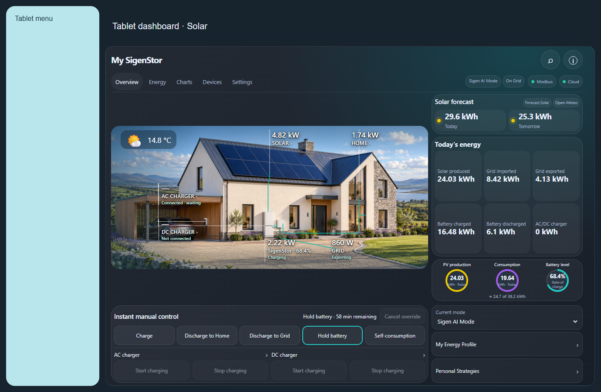

# Dashboard placement and interface settings

## Choose where to put it

**First install Sigenergy TC, restart HA and finish its setup.** Then sign in as an HA administrator. Use an editable dashboard stored by HA; built-in automatically generated pages and YAML dashboards are not changed by the placement wizard. See [installation](installation.md).

| What you want | Use this route |
| --- | --- |
| Full interface inside an existing HA page | **A** below; no starter card or YAML |
| A separate Solar dashboard in HA's sidebar | **B** below; create the dashboard yourself, then place TC |
| Full interface inside a custom shell's Solar menu | **C** below; a compatible shell is required |
| Only a few tiles, controls or charts | **D** below; use the normal HA card picker |

### A. Full interface on an existing HA page

1. Open **Settings → Devices & services → Sigenergy TC → Configure → Add to dashboard**.
2. Select the dashboard you already use, then submit.
3. In **Page or menu**, select **Page · [your page name]**. Submit again.
4. Open that dashboard/page. TC contains its own Overview, Energy, Charts, Devices and Settings tabs. No new HA dashboard is created, and existing page cards are retained.

For the full interface to use the whole page, choose a dedicated empty page rather than adding it beside many existing cards. Sections views receive a full-width card. A panel view containing only TC gives it the available page width.

### B. Separate dashboard or a new page

For a separate sidebar entry, open **HA Settings → Dashboards → Add dashboard**, choose a blank user dashboard, name it **Solar** (or your preferred name), and enable its sidebar entry. Open it and ensure it has an editable page. Then follow **A**, selecting that new dashboard and page. TC's placement wizard does not itself create an HA dashboard.

To add a new page to a dashboard from an already placed TC card, open **TC Settings → Add to dashboard**, leave **Card content** on **Dashboard · Full dashboard**, select your destination dashboard and choose **New Home Assistant page**. Enter the page name and select **Add Sigenergy TC**. This creates a page inside the selected dashboard; it does not create another dashboard.

HA's own [dashboard guide](https://www.home-assistant.io/dashboards/dashboards/) explains creation and editing of user dashboards.

### C. Drop into a custom Solar menu

1. Confirm that your shell supports embedded HA cards. TC includes an adapter for the **extended Tab A7 shell**; it does not bundle or automatically modify that personal shell. An arbitrary sidebar or kiosk plugin is not automatically a compatible shell.
2. Open **HA Settings → Devices & services → Sigenergy TC → Configure → Add to dashboard** and choose the dashboard containing the shell.
3. In **Page or menu**, select the destination labelled **Custom menu · [page] / Solar**. Select the custom-menu destination, not the surrounding ordinary HA page.
4. Tick **My custom menu supports embedded Home Assistant cards** only if verified. If the Solar slot already contains a card and you want to replace it, also tick **Replace the existing card in this menu**. Submit.
5. Open the shell's **Solar** menu. Its own sidebar/header remain; TC runs inside the selected slot. Placement does not disable kiosk mode or replace other menus.

If your shell is unsupported, use **A** or **B**. Do not confirm compatibility simply because a custom-menu destination is listed. Technical requirements are below.

### D. Individual cards and charts

1. Open your editable HA dashboard, enter **Edit dashboard**, then **Add card** and search for **Sigenergy TC**.
2. Select the integration entry in the visual editor. Choose the required view, such as **Today's energy**, **Compact battery controls**, **Solar forecast summary** or **Individual history chart**. For a chart, choose its chart kind as well. Save the card and exit editing.
3. Repeat for any additional cards. Each uses the same integration connection and cached data; you do not enter the Cloud password for each card.

Alternatively, from an existing TC card use **TC Settings → Add to dashboard → Card content** to choose a tile, control or chart before its destination. See [card options](cards.md) and the [chart catalogue](chart-catalogue.md).

### If it does not appear or looks outdated

- If TC is missing from the card picker, restart HA after the HACS installation, verify that the integration entry is loaded, then fully reload the client.
- If **Add to dashboard** has no destinations, use an administrator account and an editable user dashboard. YAML/automatic dashboards require their normal editing method.
- After an update, keep the existing entry and dashboard. Restart HA and fully reload each browser/tablet/Companion App; do not add duplicate resources or another TC card just to refresh it.
- No `card-mod`, separate chart library or third-party house card is required. Short/narrow containers keep controls readable and may scroll; the parent shell must not clip its child.



## Placement details

## Add to an existing dashboard without a starter card

Open **Settings → Devices & services → Sigenergy TC → Configure → Add to dashboard** as an HA administrator. Choose the existing dashboard, then its existing page or supported custom-menu destination. Submit adds only that card. No new dashboard is created. Existing native page content remains intact. To replace an occupied custom-menu card, tick the replacement confirmation. For a custom menu, also confirm that its shell supports embedded HA cards.

The backend saves the last five placement snapshots in HA private storage (`sigen_hybrid_dashboard_backups_<entry>`), checks for concurrent edits, saves through HA Lovelace, and verifies readback. YAML/auto-generated dashboards are not edited. Placement sends no plant command and does not reload the integration.

The in-card **Sigenergy TC → Settings → Add to dashboard** remains available, with additional individual-card/chart choices.

Choose a storage dashboard and one of these destinations:

- **New Home Assistant page** creates a panel view containing the complete interface.
- **Existing page** adds the card without removing existing content. Sections dashboards receive a full-width card; existing panel content is retained in a vertical stack.
- **Custom menu** places the interface inside a supported shell menu entry. The current adapter supports the extended Tab A7 shell. Unsupported shells still support a separate native HA page; their internal menus require a shell-specific adapter.

The in-card installer separately keeps its last five before/after configurations in the administrator's native HA frontend user storage (`sigen_hybrid_dashboard_backups`) and verifies the saved configuration. Its concurrency check is not an atomic server transaction. The native Configure wizard uses the backend snapshot storage described above. YAML and automatically generated dashboards should be edited through their owning configuration.

## Custom shell contract

The Tab A7 adapter discovers `custom:taba7-dashboard-shell` cards with a `pages` array. The extended shell must advertise `static supportsEmbeddedCards = true`, render `page.card` using HA's `loadCardHelpers().createCardElement`, forward `hass`, and size the embedded slot. The installer sets `embedded: true` and `embed_mode: shell`. The host sets `--sigen-embedded-height` to its available height and `--sigen-sticky-offset: 0px` when it owns scrolling. This shell extension is a prerequisite, not part of the integration package. The personal shell/configuration is not bundled in this repository.

The installer never assumes an arbitrary third-party shell can display a card. Add a reviewed adapter to `dashboardEmbedTargets` and `embedDashboardCard` when supporting another shell.

## One Settings home

The main navigation is Overview, Energy, Charts, Devices and Settings. Settings groups are Energy, Connections & data, Appearance, System & safety, Service and About. Existing overview shortcuts open the same editors. Scene, day/night and layout choices live in Appearance; test preview badges require `show_preview_controls: true`.

Phone views use readable power tiles under the scene instead of overlaying small labels. All three scene choices retain the same controls and detail destinations. Larger layouts keep the scene and summary side by side when space allows. Compact landscape layouts reflow daily totals into three columns so the picture, summary and all control groups fit beneath the host header. Portrait and phone layouts preserve readable vertical scrolling.

Connection setup renders the integration's native HA options flow inside TC. Credentials stay transient in the form and are submitted only to HA's options API. Cancel closes that flow. Account time/date/number/week-start preferences use HA's native per-user frontend storage; security and account management remain in HA's account page. A reload may be needed for HA itself to apply locale preferences.

Operational drafts are shared within HA under the configured integration entry, using native frontend system storage. Saving a draft does not activate a plant command or strategy. Appearance and chart selections remain browser-local. Existing browser-only drafts remain readable as a fallback and become shared when saved; no automatic overwrite of another client's draft occurs.

Charts share one sticky date/period selector and category navigation. Individual chart expansion and standalone cards remain available.


## Standalone card library

The installer has a **Card content** chooser. Select the full dashboard, a summary/control/device card, or any individual chart before choosing its destination. The same views are exposed by the native Home Assistant Sigenergy TC card configuration form. Select the integration entry to discover its sensors automatically; advanced YAML mappings remain supported.

There are 24 view presets and 26 individual chart choices. Useful combinations include:

- Phone: Live power tiles, Compact battery controls, Today's energy, Solar forecast summary.
- Tablet: Live power tiles beside Energy & battery rings, separate Battery / AC / DC cards, Power metrics chart.
- Existing desktop dashboard: Mode & strategies, Connection status, separate device charts and forecast.

Cards respond to their own available width, including when nested in a normal HA Sections layout. Control layouts support Auto, Horizontal (wraps when needed), and Vertical; Comfortable or Compact density retains touch-sized controls. The Battery card can include optional battery controls. AC/DC cards provide daily energy, charging controls and a history shortcut. Charger commands and plant writes retain the integration's existing locks.

Individual charts have their own date/period selector, legend, expansion, recorded-value table and CSV download. They do not require the full dashboard. For YAML, for example:

```yaml
type: custom:sigen-hybrid-card
config_entry: YOUR_SIGENERGY_TC_ENTRY
view: chart
chart_kind: solar
card_layout: compact
```

```yaml
type: custom:sigen-hybrid-card
config_entry: YOUR_SIGENERGY_TC_ENTRY
view: quick_controls
controls_layout: auto
density: comfortable
```

Use the configuration form's integration selector to choose the actual entry. No household identifiers are distributed in these examples.

## Theme and house lighting

Panels, charts and dialogs follow Home Assistant light/dark mode. House lighting (Auto, Day, Night or Home Assistant theme) only selects the house scene. A daylight house therefore stays compatible with dark dashboard charts, and selecting a night scene does not force a dark interface when HA is in light mode.

## Embedded sizing

The full dashboard measures its own width and available height below host headers. A custom shell can offer `--sigen-embedded-height` on the card; TC caps that to the visible viewport and recalculates on resize. Photo House keeps one aspect ratio for its artwork, cables and labels, without blurred padding. Narrower tablets use separate readable, clickable power tiles; charger readings appear only when configured.

Large enough containers retain the complete two-column overview. Short or narrow containers scroll inside the bounded drop-in rather than clipping controls or reducing text and touch targets beyond readability. Other tabs retain their content scrolling. An arbitrary third-party shell must itself offer a bounded area or allow scrolling; TC cannot override an external shell that clips or hides its entire child.


## Frontend updates and installed chargers

From 0.2.4, startup registers the frontend at a versioned URL and upgrades an existing unversioned or older TC resource in place. After updating in HACS, restart HA and reload the tablet or browser web view once so it observes the changed resource configuration. A backend update alone cannot replace modules already running in an open web view. Other Lovelace resources are not changed.

Photo/house/flow and narrow-screen power tiles use the discovered installed-device inventory as well as explicitly mapped sensors. An installed AC/DC charger remains visible when instantaneous power is unavailable; its label opens the same device details and the cable remains drawn without a false flow animation. A missing power reading is shown as a dash, never invented as zero. Explicitly disabled entity mappings remain excluded.
