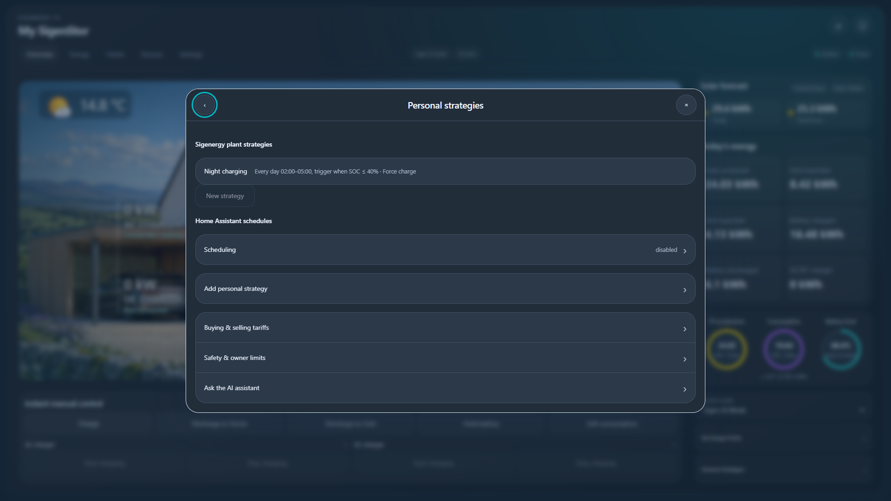
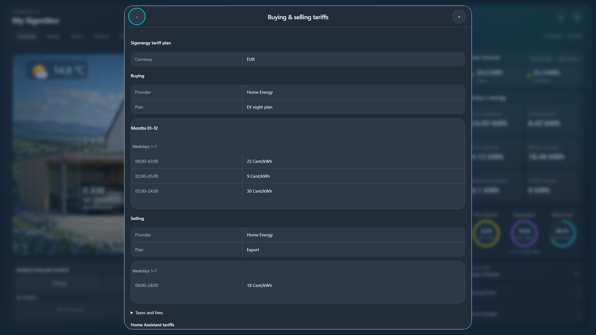

# Existing mySigen settings

TC reads saved plant configuration using the Cloud account configured in Home Assistant. A browser session, browser token, developer application, NBI key and external backend are not required. Local Modbus monitoring continues independently.

Open the relevant setting to retrieve its current plant values. These optional reads reuse the authenticated account client, its six-second minimum request spacing and provider cooldowns. They are cached for five minutes; they are not added to every monitoring poll. Configuration reads have their own locks so an optional battery-module refresh does not block the entire settings interface. A provider failure remains an error, rather than becoming an empty list, zero or an invented default.

## Where to find saved configuration

| Configuration | Location | Behaviour |
| --- | --- | --- |
| mySigen Personal Strategies | Personal strategies → Sigenergy plant strategies | Lists native rules; New/Change use the native assistant, Rename/Delete use direct native requests. See [native strategies](native-strategies.md). |
| TC schedules | Personal strategies → Home Assistant schedules | Existing HA schedule editor and explicit master enable. Native rules are never copied into this runner. |
| Native operating profiles | My Energy Profile → Plant operating profiles | Lists advertised custom profiles and their settings. An empty custom-profile list does not imply that the plant has no Personal Strategies. |
| Native buying/selling tariffs | Buying & selling tariffs → Sigenergy tariff plan | Reads the supplier, plan, effective periods, time bands, currency and provider price unit, plus taxes/fees. |
| HA import/export prices | Buying & selling tariffs → Home Assistant tariffs | Existing local price editor. Saving these prices does not update the native tariff contract. |
| Charger schedules | Selected charger → Schedule | Native schedules and HA drafts appear separately. |
| Charging records | Selected charger → Charging records | Native records, filterable dates and history pages; partial history is not presented as a complete lifetime total. |
| Network information | Inverter → Network; AC charger → Connectivity | Reads the selected device, preserving the existing Modbus connection diagnostics. Credentials are omitted. |
| AC settings | AC charger → More | Reads load-management, output/phase and off-grid settings. |
| OCPP and cards | Selected charger → More → OCPP / Card Management | Reads that charger's native configuration. |
| Battery preheating | My Energy Profile → Battery Preheating Scheduling | Shows saved windows even while preheating is disabled. |
| Indicator lights | Settings → System → Indicator lights | Reads the front and LED-strip channels separately; absent values remain unknown. |
| Backup history/events | My Energy Profile → Backup History / Backup Event Center | Reads native history pages. |
| Energy saving and aggregator allocation | My Energy Profile | Reads the native configuration without enrolling in a VPP or changing allocation. |
| Service provider | Settings → System → System information | Shows the plant's returned service-provider records. No installer contact is invented when the service returns none. |

Other preset collections above remain observations. Custom operating-profile editing, native tariff synchronization, native charger-schedule editing, OCPP/RFID administration, preheating, indicator, energy-saving and aggregator writes are **not implemented by this reader**. Native Personal Strategy actions have their own [owner-confirmed controller](native-strategies.md). These are integration coverage boundaries, not claims that Sigenergy forbids an operation. TC's existing journalled control settings remain available as described in [owner settings](owner-settings.md).

Grouped solar priorities returned by the current profile are displayed without flattening them into the older priority writer. TC does not send an unverified flat payload over grouped settings. Existing DC V2X mode is readable and remains selected in the charging-mode screen; it is not silently displayed as Fast charging. Vehicle-discharge dispatch remains a separate unsupported workflow.

## Read and write safeguards

- Every request is bound to the configured plant and, where needed, an exact installed device serial. A foreign/stale device selection is rejected.
- Reading does not enable controls, claim a Cloud override, activate a schedule or change plant configuration. It works with TC writes disabled.
- Editable settings still use fresh readback, revisions, identity checks, the existing safety checks and durable recovery. A cached preset never authorizes a command.
- Disabled grid limits may have an unset owner value. TC preserves that distinction from an explicit zero-watt limit.
- Native Personal Strategies use a fixed POST list query. The separate native strategy controller accepts only its supported owner actions, not a generic endpoint proxy.

## Validation scope

The 0.2.7 candidate was checked through a saved EU owner account in isolated HA Test with every Test write locked. Native Personal Strategies, tariffs, operating-profile catalogue, energy profile, preheating, both lighting channels, inverter/AC network details, AC/DC schedules and records, AC additional settings, both OCPP/card/authorization reads, backup history/events, energy saving and aggregator settings returned through the integration client. Current DC V2X mode and disabled unset grid limits were also checked.

The tested account had no custom operating profiles or native charger schedules. Those empty results were distinguished from its existing Personal Strategy; custom-profile identity rejection and list/cache behaviour are covered by software tests. Other accounts, regions, firmware and physical command acceptance require owner alpha testing. No plant commands were sent during this validation.

Documentation screenshots use synthetic, non-private account data.
