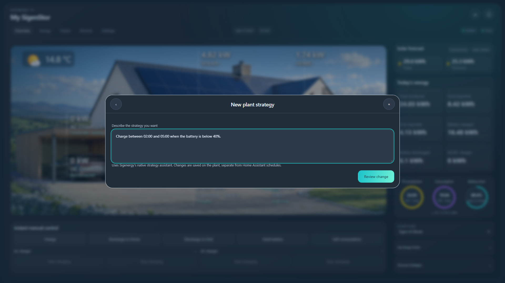
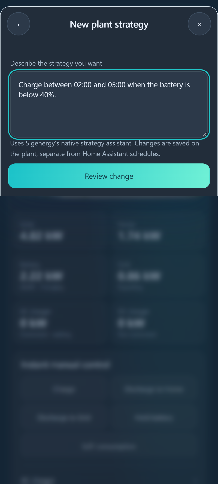

# Manage mySigen Personal Strategies

Open **Personal strategies → Sigenergy plant strategies**. These are the rules saved on your Sigenergy plant. **Home Assistant schedules** are separate TC schedules; changing one does not silently copy, enable or delete the other.

Cloud must be connected and **Cloud plant control** enabled. Managing native strategies requires an HA administrator. Modbus alone can monitor the plant but cannot manage these native rules. No NBI key, browser login or separate AI subscription is required.

## New and changed rules

1. Select **New strategy**, or open an existing strategy and select **Change strategy**.
2. Describe the desired dates/days, time window, battery condition and action. For an existing rule, describe what should change.
3. Select **Review change**, check the exact request, then **Send to Sigenergy**.
4. TC displays Sigenergy's response and proposed rules. Refine the request if necessary. A returned confirmation button opens another explicit review before it is sent.
5. Return to **Personal strategies** and inspect the saved plant rule, including its condition and action.

Sigenergy's owner client creates and modifies these rules through its native personalization assistant. TC uses that same conversation protocol rather than inventing a structured rule-save API. This is Sigenergy's assistant, separate from TC's planned optional external AI providers. Sending a request is an owner-authorized plant operation; do not assume every response will be a non-executing draft. Always review the saved rules afterward.

The interface polls the selected conversation only while it is open, at ten-second intervals for up to twelve automatic checks. **Refresh response** remains available if generation takes longer. Calls reuse the account's existing authentication, request pacing and cooldowns. There is no additional continuous assistant polling.

## Rename and delete

Open a native strategy, then choose **Rename** or **Delete**. Rename accepts up to 60 characters. Both actions show a review before dispatch and require fresh native readback before TC reports success.

Deleting removes the native rule from the plant. It has no automatic Undo. TC saves the previous rule data in HA private storage before dispatch; it does not pretend that recreating an AI-generated rule is a guaranteed inverse of deletion. If necessary, use the saved conditions/action to recreate it through TC or mySigen.

## Conflicts, interruptions and scope

- Each preview is bound to the HA user, integration entry, configured plant and fresh rule-list revision. It expires after ten minutes.
- If the rules or operating mode change after review, reopen them before submitting. An action cannot overwrite a concurrently changed list using an old preview.
- A preview is consumed before mutation. A timed-out mutation or proposal confirmation is never automatically retried after another click, reconnection or restart.
- Native confirmation buttons come only from the current owner-scoped conversation. Callers cannot supply arbitrary endpoints, plant IDs, conversation IDs or action payloads.
- A response associated with another plant is rejected. AI text alone is not treated as proof of a saved rule; return to the freshly read plant list.
- Finishing a TC control/recovery operation takes priority over starting a native strategy change. Monitoring and HA-owned schedules keep their existing behavior.

Pending request snapshots are stored under HA's private `sigen_hybrid_native_strategy_<entry-id>` storage record. They include rule data needed for review, never Cloud credentials. They are not exposed in public screenshots or repository fixtures.

## Alpha validation

The controller and dialogs are covered by automated identity, permission, stale-revision, readback, timeout and no-replay tests. Real-account read-only checks retrieved existing strategy conversations and a new informational answer without confirming any proposal; the native rule list was unchanged before and after. Browser interaction tests exercise New, Change, Rename, Delete, cancellation and proposal confirmation at six desktop/tablet/phone viewports. HA Test startup checks serve the new module and reject strategy writes from an inert demo.

Creating, modifying, renaming and deleting a real disposable plant rule remain a separate supervised acceptance test. These software and read-only checks do not establish that every account, region or firmware accepts each write.

Screenshots use synthetic account data.
