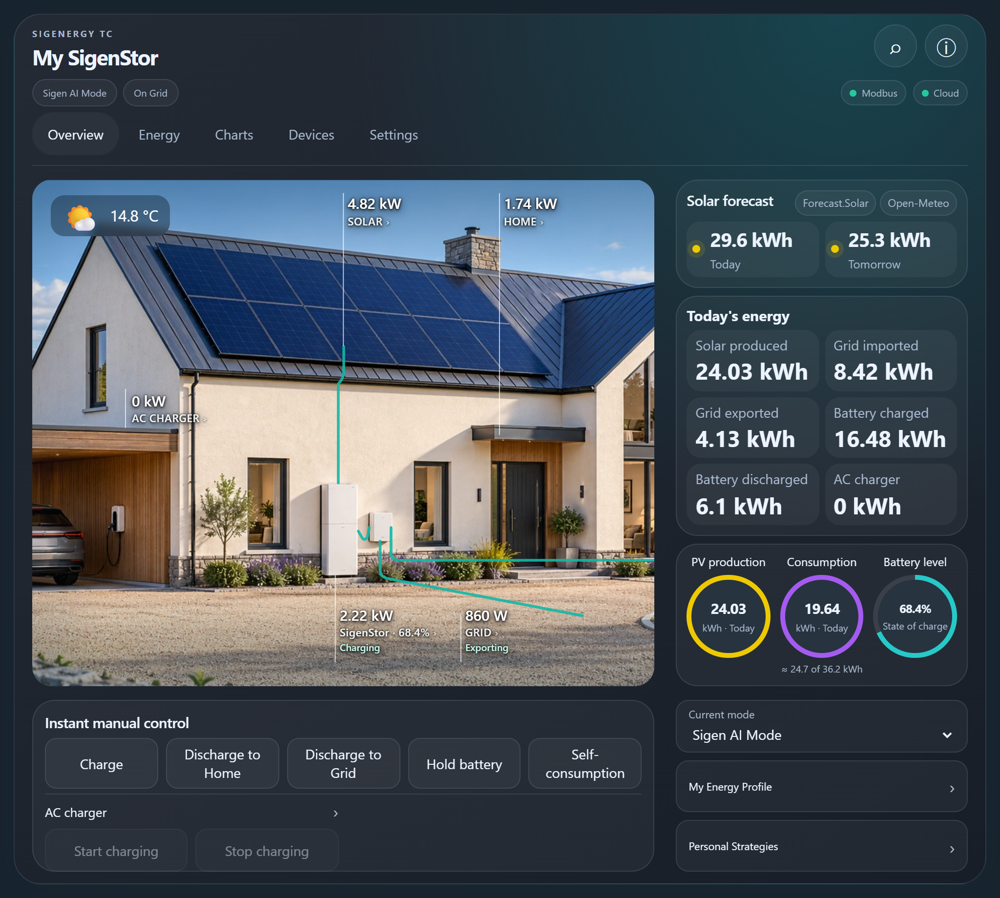
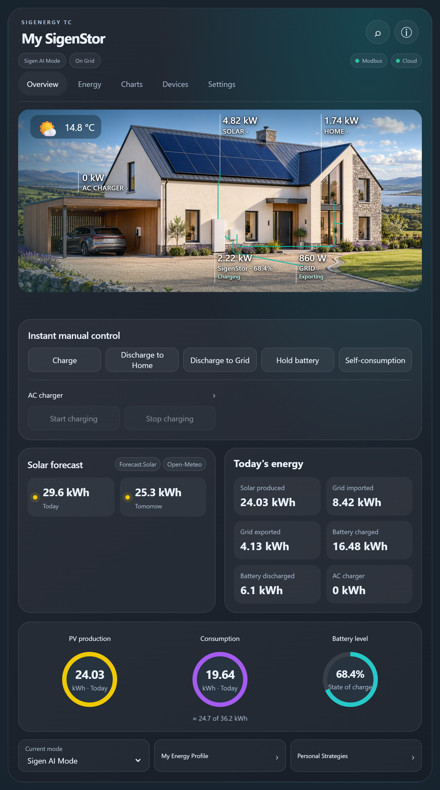
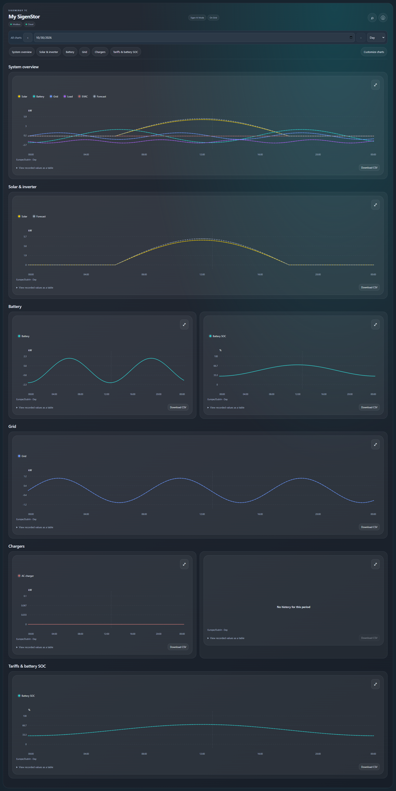
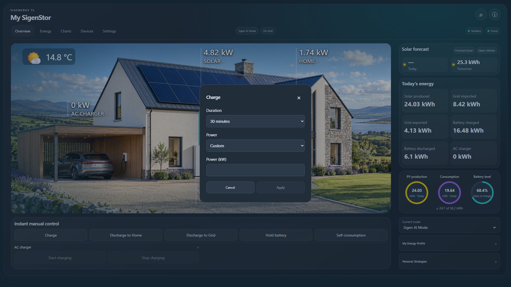

# Screenshot gallery

Example readings are illustrative and contain no private account/plant details. Desktop, tablet and phone layouts use the same bundled card. These images are maintained with release changes.

## Desktop

## Tablet

Smaller landscape and portrait screens retain readable controls and allow vertical scrolling when needed.

Additional tablet layouts

## Phone

## Charts and controls

To check the documentation examples in a local Chrome installation, install Playwright (`npm install --no-save playwright`) and run `node tools/check_layout.cjs`. The check tests widget containment, ring overlap, forecast headings and horizontal overflow at five desktop/tablet/phone viewport sizes, then refreshes the overview screenshots. These are CSS viewport sizes; the tablet and phone cases also cover higher display pixel density.
