# Screenshot gallery

Example readings are illustrative and contain no private account/plant details. Desktop, tablet and phone layouts use the same bundled card. These screenshots show the 0.2.9 Beta frontend.

## Desktop

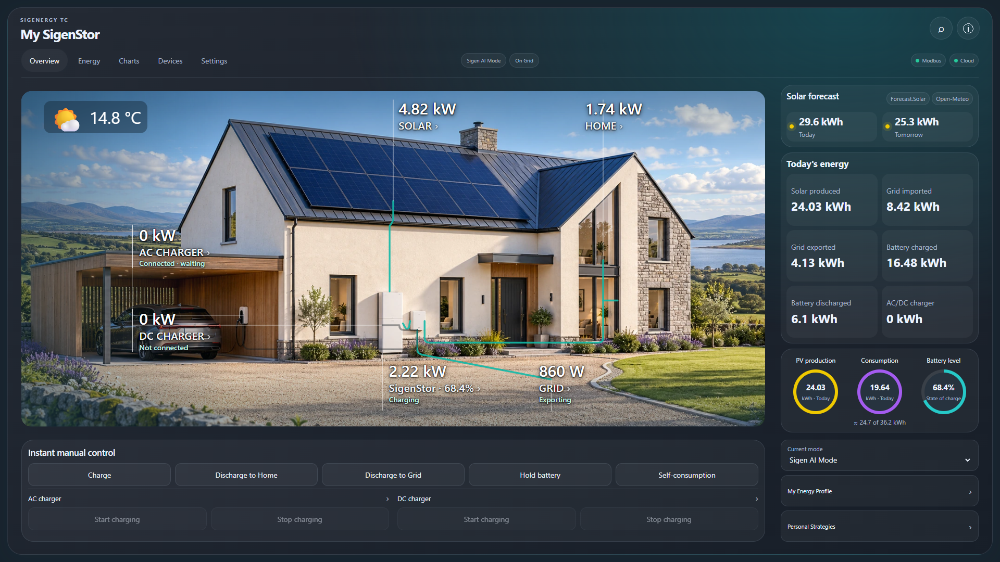

## Tablet

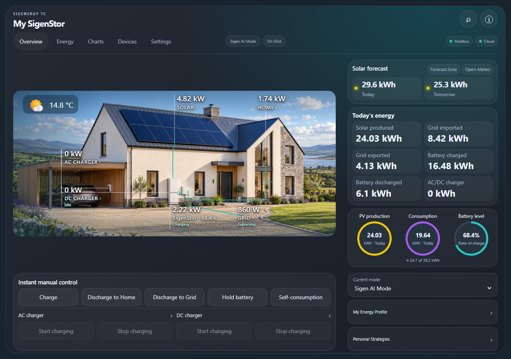

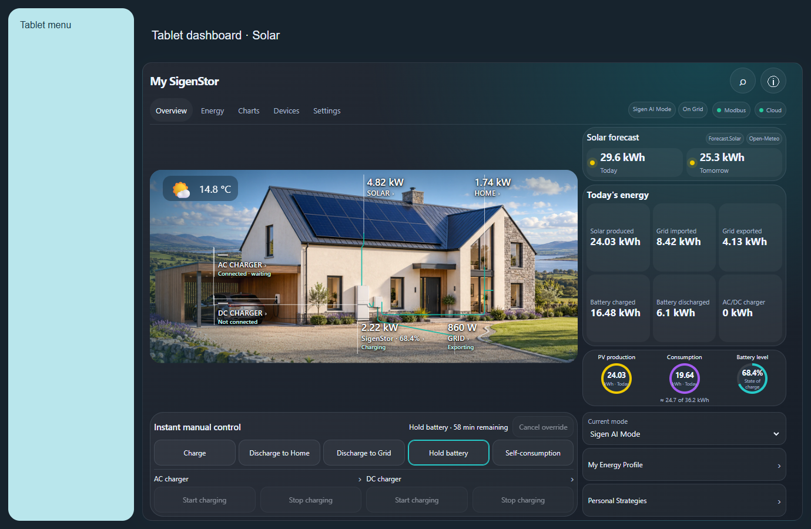

Smaller landscape and portrait screens retain readable controls and allow vertical scrolling when needed.

Additional tablet layouts

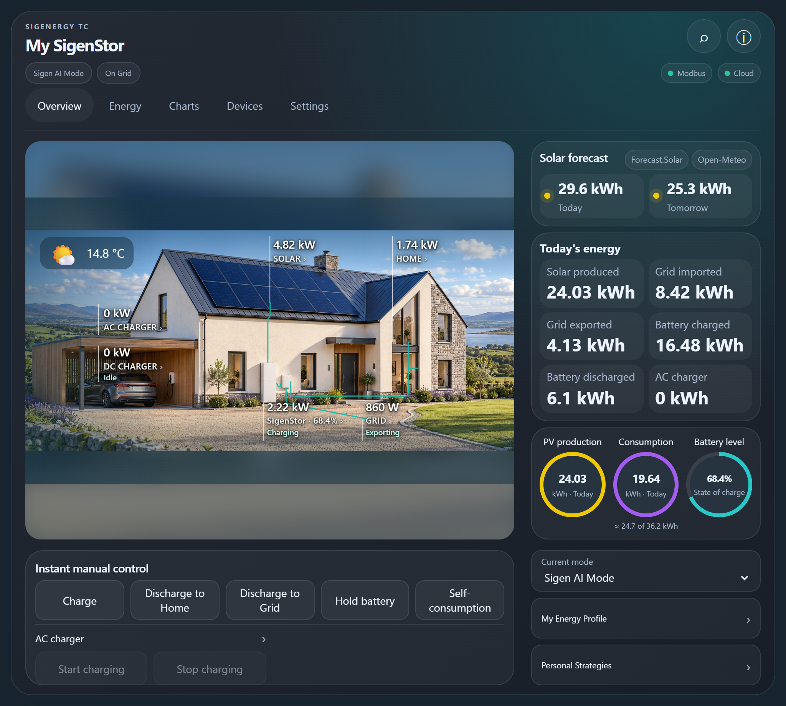

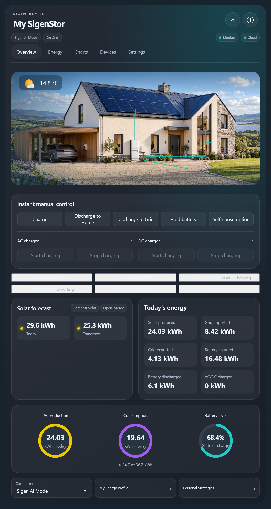

## Phone

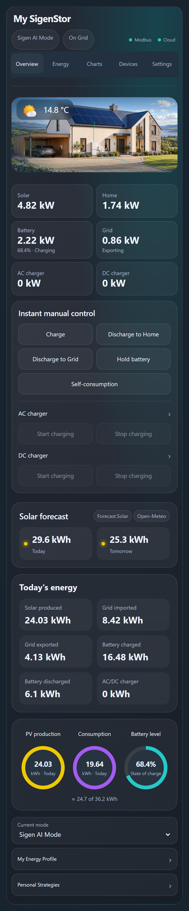

## Charts and controls

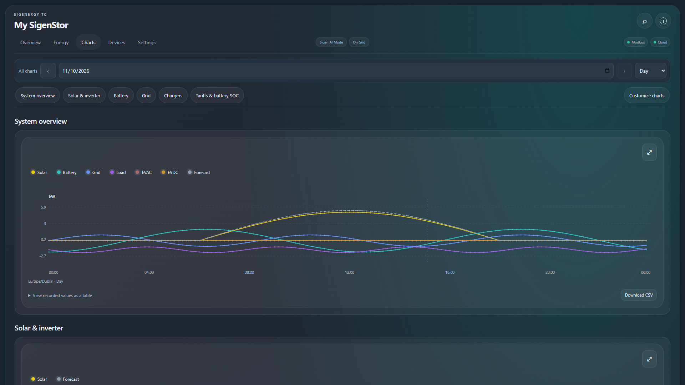

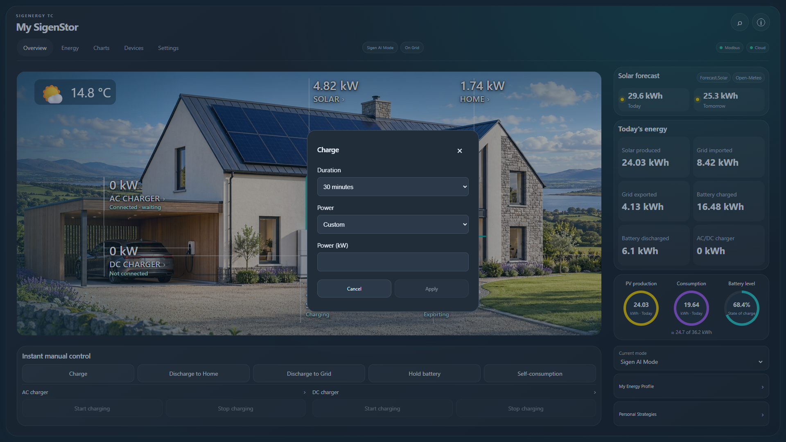

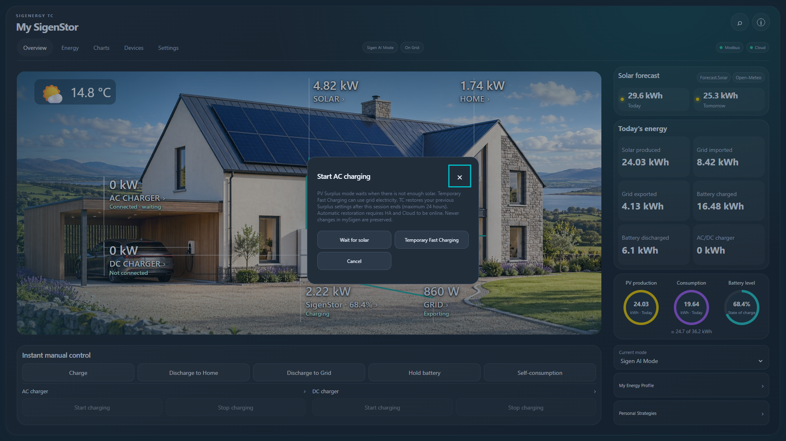

To check the documentation examples in a local Chrome installation, install Playwright (`npm install --no-save playwright`) and run `node tools/check_layout.cjs`. The check tests widget containment, ring overlap, forecast headings and horizontal overflow at five desktop/tablet/phone viewport sizes, then refreshes the overview screenshots. These are CSS viewport sizes; the tablet and phone cases also cover higher display pixel density.

## Native configuration

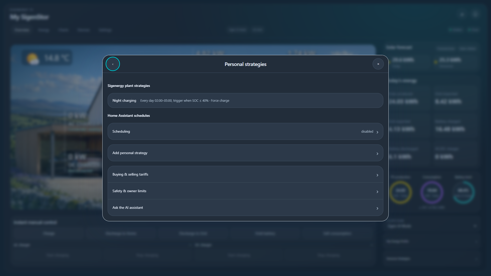

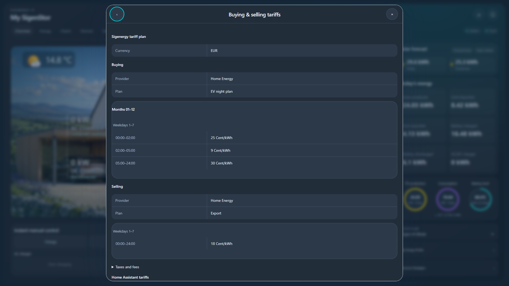

## Native strategy controls

[Create, change, rename and delete native strategies](native-strategies.md). Public screenshots use synthetic data.

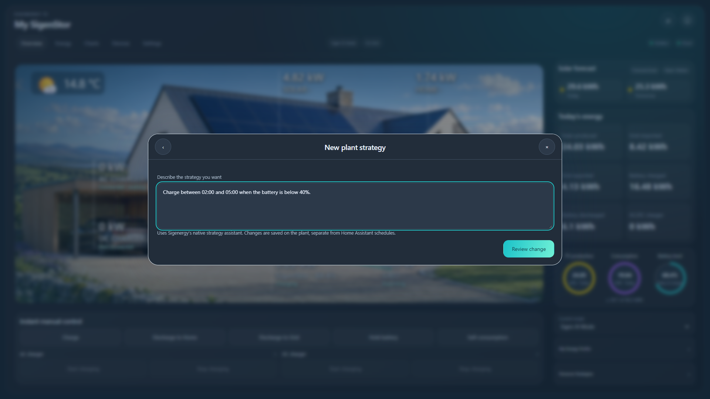

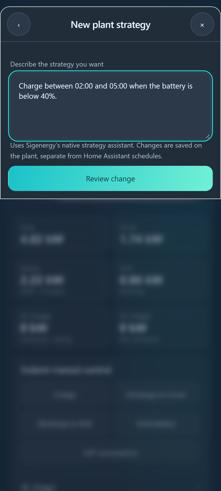
